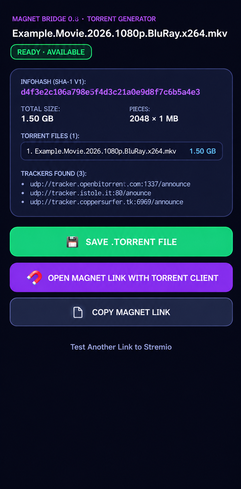

  

<h1 align="center">Magnet Bridge</h1>

  <strong>Turn Stremio Android streams into real BitTorrent magnet links and <code>.torrent</code> files.</strong>

  <a href="https://magnetbridge-stremio-stream-to-magnet-apk-hub.ai.studio/">Visit the website</a>
  ·
  <a href="https://github.com/leffmarques/MagnetBridge/releases">Download the latest APK</a>

Magnet Bridge is an Android companion app designed to work as an external player handler for **Stremio**.

When Stremio Android sends a local HTTP stream URL instead of a magnet link, Magnet Bridge intercepts it, extracts the torrent infohash, retrieves the available torrent metadata, and provides options to open the magnet link in a torrent client or save a real `.torrent` file.

## Screenshots

  

## Features

- **Stremio integration** — works as an external player handler on Android.
- **Magnet link extraction** — extracts the BitTorrent infohash from Stremio's local stream URL.
- **Torrent metadata discovery** — retrieves available metadata for the torrent.
- **Torrent information** — displays the infohash, total size, piece information, file list, and identified trackers.
- **Save `.torrent` file** — generates and saves a real torrent metadata file.
- **Open with your torrent client** — sends the magnet link to an installed torrent client.
- **Copy magnet link** — copies the generated magnet URI to the clipboard.

## Why Magnet Bridge?

Stremio on desktop can pass magnet links directly to external applications. On Android, however, external player integrations may receive a local HTTP URL served by Stremio instead.

This can cause problems when using download managers or torrent clients that expect a magnet link.

Magnet Bridge acts as the bridge between these two formats, allowing Android users to work with the original torrent instead of treating the local stream URL as a regular HTTP download.

## How to use

1. Install Magnet Bridge on your Android device.
2. Open Stremio and go to the external player settings.
3. Select **Magnet Bridge** as your external player.
4. Start playing a torrent-based stream in Stremio.
5. When Android opens Magnet Bridge, wait for the torrent metadata to become available.
6. Choose one of the available actions:
   - **Save Real `.torrent` File**
   - **Open in Torrent Client (Magnet)**
   - **Copy Magnet Link**

A compatible torrent client must be installed to open magnet links.

## How it works

1. Stremio sends a local stream URL to the selected external player.
2. Magnet Bridge extracts the torrent's v1 infohash.
3. The app uses the infohash to discover and retrieve the torrent metadata.
4. Once the metadata is available, Magnet Bridge displays the torrent information and makes the available actions accessible.

Magnet Bridge does not act as a video player or torrent download client. It prepares the torrent information and hands the magnet link over to your preferred torrent client.

## Download

Get the latest Android APK from the [GitHub Releases](https://github.com/leffmarques/MagnetBridge/releases) page.

You can also visit the [Magnet Bridge website](https://magnetbridge-stremio-stream-to-magnet-apk-hub.ai.studio/).

## Compatibility

- Android devices
- Stremio for Android
- An installed torrent client for opening magnet links

## Disclaimer

Magnet Bridge is an independent project and is not affiliated with, endorsed by, or officially associated with Stremio.

This application does not host, provide, or distribute torrent content. Users are responsible for ensuring that their use of BitTorrent complies with applicable laws and copyright regulations.

---

**Magnet Bridge** — connecting Stremio streams to the BitTorrent ecosystem.
